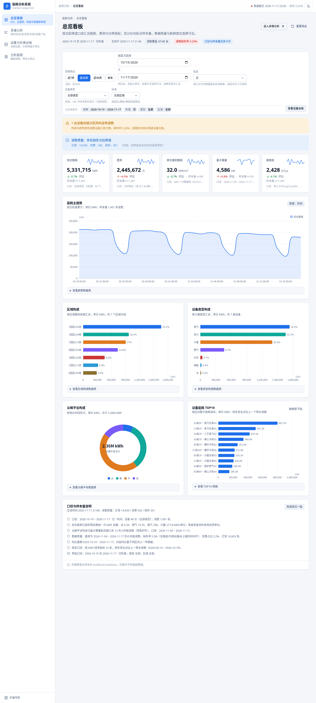
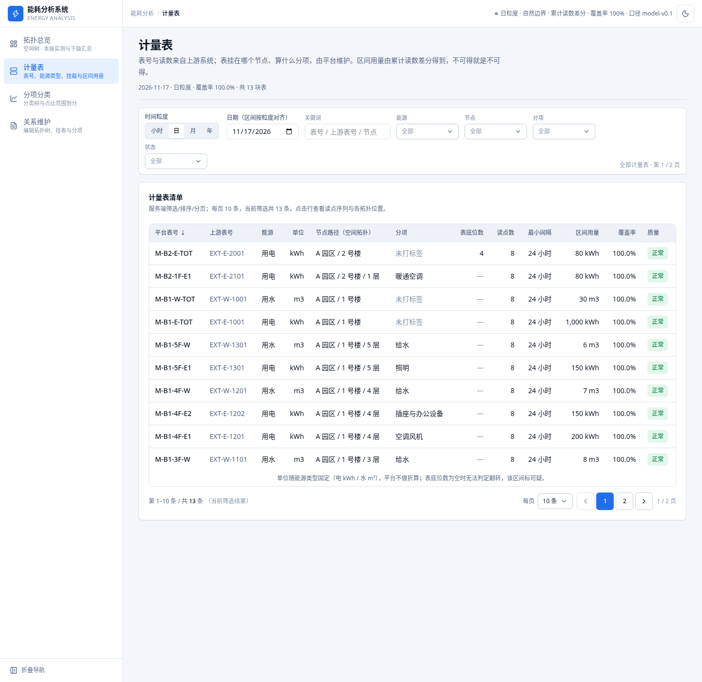

# 能耗分析系统（Energy Analysis）

基于设备抄表数据生成多维度能耗分析与分析报表的全站框架。

技术栈：**React Router v7（framework mode，Remix 官方后继）+ Radix UI + Tailwind CSS v4 + ECharts 6 + TypeScript**，SSR 渲染，无外部服务依赖（内置确定性 mock 数据源，可切换真实 API）。



## 快速开始

```bash
npm install        # 依赖已装好时跳过
npm run dev        # http://127.0.0.1:5173
npm run build      # 生产构建（client + SSR）
npm run start      # 起生产服务，PORT=3000 可改
npm run typecheck  # react-router typegen + tsc --noEmit
npm run perf       # mock 数据层 34 项自检 + 聚合性能
npm run seed:dump  # 抽样导出 mock 设备/读数，核对字段口径
```

## 页面（业务模型只读视图）

| 路由 | 页面 | 内容 |
| --- | --- | --- |
| `/` | **拓扑总览** | 空间树即计量层级；每节点分电/水两组展示「本级实测 / 下级汇总 / 差额 / 口径」，差额仅两侧都有时计算 |
| `/meters` | **计量表** | 服务端筛选/排序/分页（QueryState 全进 URL）；读点数、最小读点间隔、区间用量、覆盖率、质量；行内抽屉看读点序列与门禁问题 |
| `/categories` | **分项分类** | 分类树 + 可进占比的表 + 被排除表及原因（总表不参与分项占比） |
| `/topology/edit` | **编辑拓扑关系** | 单页维护：切换/新建拓扑、节点增删改、改父子、挂表/摘表，保存即写配置文件 |




## 架构

```text
app/
  root.tsx                  HTML 骨架 + ErrorBoundary + 全局样式注入（Lead 冻结）
  routes.ts                 路由表（4 个页面 + 1 个导出资源路由）
  app.css                   设计令牌（Tailwind v4 @theme，浅/深两套语义色）
  lib/
    cn.ts                   clsx + tailwind-merge
    query.ts                QueryState：DashboardQuery / LedgerQuery 的 parse/serialize（筛选进 URL）
    format.ts               数值/百分比/时间/粒度格式化（同一处口径）
    energy/
      types.ts              领域类型契约（Lead 冻结：Device/Reading/聚合结果/报表/DataSource）
      mock-source.ts        确定性 mock 抄表数据源（按需逐片生成，不铺全量数组）
      source.ts             DataSource 单例 + setDataSource 切换
      analytics.ts          聚合与报表：buildOverviewData / buildAnalysisData / buildLedgerPage / buildReport …
      dictionary.ts         业务字典与状态色映射
      granularity.ts timeframe.ts units.ts  粒度护栏、固定 +08:00 时间函数、单位折算
  components/
    ui/                     22 个 Radix + Tailwind 基础件（button/card/table/stat/tabs/select/drawer/dialog/…）
    charts/                 EChart 客户端封装（ResizeObserver + dispose + 深色重建）+ 7 个 option 构造器
    layout/                 AppShell（可折叠侧栏/移动抽屉/主题切换/数据新鲜度）、PageHeader、FilterBar
  routes/                   overview / analysis / devices / reports / reports.export
scripts/                    perf-check（自检+性能）、dump-mock（抽样导出）
docs/
  CONTRACT.md               并行开发契约（模块导出、写入范围、页面口径）
  ui-extension.md           项目扩展规范（术语表、状态枚举与色映射、告警级别、指标口径、页面清单）
  screenshots/              四页截图
```

### 数据接入

页面只依赖 `DataSource`（`app/lib/energy/types.ts`），当前实现是 `createMockDataSource(seed?)`：

```ts
import { getDataSource, setDataSource } from "~/lib/energy/source";
import type { DataSource } from "~/lib/energy/types";

const current = getDataSource();   // mock，48 台设备，2025-05-01 → 2026-11-17
setDataSource(createHttpDataSource(baseUrl));  // 实现 listDevices/getDevice/listReadings/coverage 即可
```

mock 特性：确定性（同 `deviceId + ts` 恒定）、工作日/周末曲线、季节因子、峰谷平时段、约 1.9% 缺失 + 2.1% 估算、3 台离线 / 1 台故障 / 1 台归档；`15min` 窗口 >7 天、`hour` >90 天自动降粒并在结果 `notes` 说明。

性能（打包后 node 实测中位数）：`buildOverviewData` 近 30 天/日 34 ms，近 7 天/小时 21 ms，566 天/日 103 ms；`buildLedgerPage` 12 ms；`buildReport` 45 ms。

## 设计约定

- 语义令牌：`bg-bg / bg-surface / bg-surface-2 / border-line / text-fg(-muted|-subtle) / bg-brand / text-tariff-{sharp,peak,flat,valley} / text-series-1..8`，禁止硬编码色值；浅色/深色两套由 `.dark` 覆盖。
- 百分比必须带样本量（`Stat.sampleSize`、表格列、报表表头），数据质量与新鲜度在第一层可见。
- 筛选/排序/分页全部进 URL（可分享、刷新不丢、返回不重置）；图表都有 `ariaLabel` + `<details>` 表格化数据出口。
- 交互与文案遵守 `admin-ui-spec`：同尺寸骨架、空/错/载三态、浮层必带标题与取消/确认、L1 全选必须声明范围。

## 业务模型层（新平台范围）

`app/lib/model/` 是当前真正的平台底座（详见 [docs/model.md](docs/model.md)）：

- **只电、水两种能源 × 自然小时/日/月/年四档粒度**，不做跨能源折算、不做电价、不做碳排；电与水不可相加。
- **不落库**：上游给表号与自然边界累计读数，平台只读 + 派生。
- 平台维护三份关系：**拓扑（空间树）、分项分类、表与二者的绑定**。末端节点必须挂表；中间节点可挂总表也可不挂；两者都有时「本级实测」与「下级汇总」共存，差额用于对账。
- 累计读数差分出四档用量，端点缺读数时用量为 `null`（不外推、不补零），其余校验逻辑已移除。
- 每个结果都带口径：粒度、对齐方式（自然边界 + 累计读数差分）、覆盖率、口径版本、能力边界标签。

`app/lib/energy/*` 是上一版分析层（含 7 类能源、15 分钟粒度、跨能源折算/电价/碳排），已冻结待按新模型重建。

## 已知边界

- 布局与交互只做了 SSR 输出 + 无头 Chrome 截图校验；抽屉/主题切换/键盘焦点等浏览器内交互未做自动化回归。
- 台账只提供 L1 全选（当前页）；L2「筛选结果全选」需服务端精确计数接口，见 `docs/ui-extension.md` 待补项。
- 分时电价、碳排放因子目前是 `app/lib/energy/units.ts` 内的常量（口径已写进报表 `header`），接入计费系统时替换为可配置表。
- 设备类型筛选当前是单选 + chips 外显；多选需给 `Select` 加多选变体。
